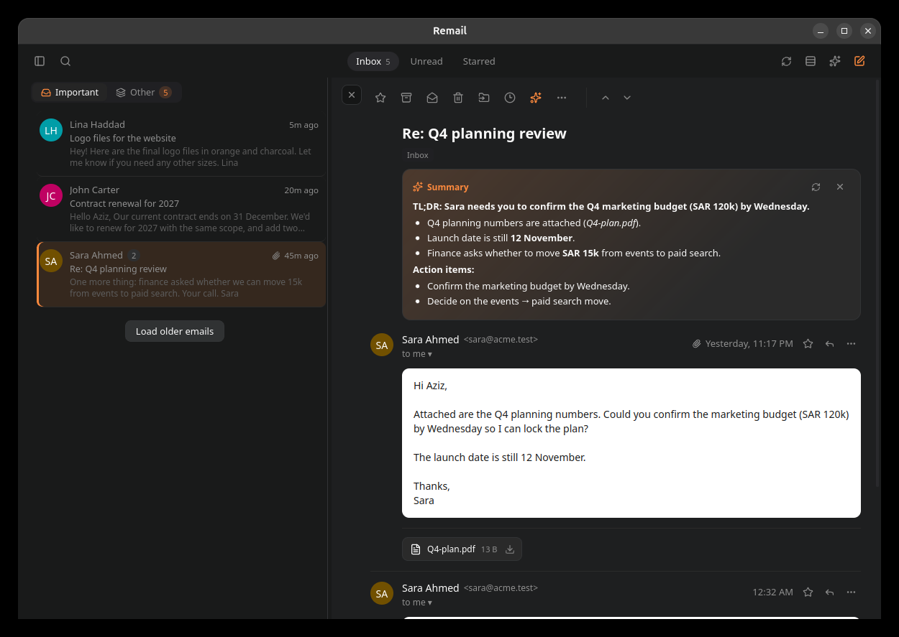
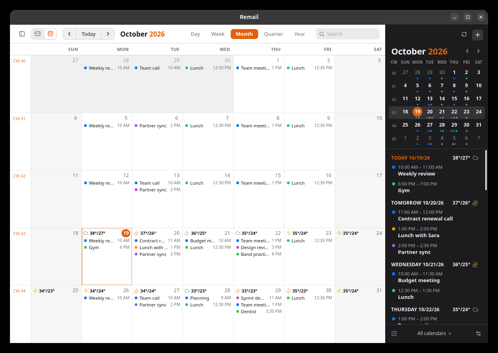

# Remail


A fast, private desktop email client written in Rust. It brings a unified inbox, snooze, send
later, undo send, one-click unsubscribe and keyboard-first navigation, and talks to your mail
servers directly. On top of that: a split reading pane, a Smart Inbox, a Notion-style composer, a
calendar, a bring-your-own-key AI assistant, and MCP support. No vendor cloud and no telemetry.
Your mail and settings stay on your computer.

- **Engine:** Rust (`crates/remail-core`): IMAP sync, SMTP, SQLite cache with full-text search,
  local schedulers for snooze and send later.
- **Desktop shell:** Tauri 2 (`src-tauri`). Windows, tray, notifications, `mailto:` handling.
- **UI:** Svelte 5 + TypeScript (`src/`), rendered in the system webview.
- **Platforms:** Linux (`.deb`, AppImage), Windows (installer `.exe`, `.msi`) and macOS (universal `.dmg`).
  The `.deb` is about 11 MB.



More: [Smart Inbox](docs/screenshots/smart-inbox.png) · [AI assistant](docs/screenshots/assistant.png) ·
[AI reply](docs/screenshots/ai-reply.png) · [MCP tool approval](docs/screenshots/mcp-approval.png) ·
[full-width layout](docs/screenshots/thread.png) · [compose](docs/screenshots/compose.png) ·
[snooze](docs/screenshots/snooze.png) · [command palette](docs/screenshots/command-palette.png) ·
[sidebar](docs/screenshots/sidebar.png) · [settings](docs/screenshots/settings.png) ·
[AI settings](docs/screenshots/settings-ai.png) · [connections](docs/screenshots/connections.png) ·
[light theme](docs/screenshots/inbox-light.png) · [auto-clean](docs/screenshots/autoclean.png) ·
[auto-clean settings](docs/screenshots/autoclean-settings.png) · [Arabic email](docs/screenshots/arabic-reading.png) ·
[writing in Arabic](docs/screenshots/arabic-compose.png) · [Sign in with Microsoft](docs/screenshots/microsoft-sign-in.png)



Calendar: [quarter (dark)](docs/screenshots/calendar-quarter.png) · [week](docs/screenshots/calendar-week.png) ·
[quick add](docs/screenshots/calendar-quick-add.png) · [event](docs/screenshots/calendar-event.png) ·
[settings](docs/screenshots/calendar-settings.png) · [iCal subscription](docs/screenshots/calendar-ical.png) ·
[Outlook calendars](docs/screenshots/calendar-outlook.png) ·
[quarter (light)](docs/screenshots/calendar-light.png)

## Features

| Area | What you get |
|---|---|
| Accounts | Any IMAP/SMTP account (TLS, STARTTLS, or plain for local servers). Presets for Gmail, iCloud, Yahoo, Fastmail, Zoho, AOL and GMX, with app-password help. **Sign in with Microsoft** for Outlook.com, Hotmail, Live, MSN and Microsoft 365 / Office 365 (OAuth 2.0 with PKCE in your browser, then XOAUTH2 for IMAP and SMTP; see below). Passwords and sign-in tokens live in the system keyring. |
| Unified inbox | All accounts in one list, colour-coded per account, with a per-account "Show in Unified Inbox" switch. |
| Layout | **Split view** (list + reading pane, resizable) or a full-width list. Toggle with `Ctrl+\`. After archiving or deleting, Remail opens the **next unread email** (or next / previous / back to list, in Settings). |
| Smart Inbox | The Inbox splits into **Important** and **Other**, and Other filters by Updates, Promotions, Social and Forums. Sorting is local. It uses mailing-list and bulk-sender headers, marketing platforms, social networks and automated senders. People you've written to always count as Important, as do threads you took part in and starred threads. "Always put mail from … in" teaches it per sender. Optionally the AI refines it. You can choose to notify only for Important mail. |
| Auto-clean | Optionally removes read mail you don't keep: Promotions, Updates, Social, Forums and **one-time codes** (OTP / verification / sign-in codes, detected in English and Arabic). Per kind, choose right after reading or 1 hour to 30 days later, and Trash or Archive. Unread mail, starred mail and conversations you wrote in are never touched. "Right after reading" waits until you move on, and every clean-up shows an Undo. |
| Calendar | A calendar **inside the main window**, next to your mail: the Mail/Calendar switch at the top left, `g c` / `g i`, the sidebar or the tray. A dark panel on the right of the grid has a mini month with week numbers and event dots and a three-week agenda. Views: Day, Week, Month, Quarter and Year. It shows multi-day bars, "N more…", search, quick add ("Lunch with Sara tomorrow 1pm", "Standup every weekday 9:30"), repeating events (this occurrence or the series), alerts as desktop notifications, and an optional 16-day weather forecast (Open-Meteo, no account). **Outlook calendars** (Outlook.com, Hotmail, Live, MSN, Microsoft 365) connect by themselves when you sign in with Microsoft: every calendar of every Microsoft account, two-way, through Microsoft Graph. **Two-way CalDAV sync** with iCloud, Fastmail, Nextcloud, Zoho, Yahoo, GMX, mailbox.org, Posteo and others, using the mail account's app password, plus read-only **iCal subscriptions** (`webcal://` / `.ics` links: Google Calendar, holidays, sports…). |
| Arabic / RTL | Every paragraph takes the direction of its first letter, so Arabic (and Hebrew, Persian, Urdu…) reads from the right while English lines in the same email stay on the left. This applies when reading (HTML and plain-text mail, lists, quotes, and plain-text lines that mix both), when writing (each line follows what you type; the sent email carries `dir="rtl"` on Arabic lines so other mail apps show them from the right too), to subjects (a leading "Re:" / "Fwd:" doesn't count) and to AI text. A sender's own right-to-left markup is kept. Arabic uses Noto Sans Arabic. WebKitGTK draws a word ending in a mark (tanween, as in "مرحباً") a few pixels above the rest of its line; Remail works around it: in the reading pane with an invisible Arabic letter mark (U+061C) after word-final marks (vowel marks stay exactly placed; copied text keeps that invisible mark, search ignores it), in the composer and lists with OpenType mark positioning off (fully vowelled ligatures such as "صَلَّى" may show a mark one letter off there). |
| AI assistant | Bring your own key: any **OpenAI-compatible** (OpenAI, OpenRouter, Gemini, Groq, DeepSeek, Ollama/LM Studio locally…) or **Anthropic-compatible** API. It can summarize a conversation, write a reply ("AI assistance"), and compose, improve, shorten, change the tone of or translate text in the composer. A chat panel (`Ctrl+J`) searches, reads and drafts mail with tools, and asks before it sends, moves or snoozes anything. |
| MCP | **Remail as an MCP server**: Claude Code, Claude Desktop, Cursor and other agents can search, read and draft your mail. Sending and organizing are off until you allow them. It uses Streamable HTTP on `127.0.0.1` with a token, or the `remail --mcp` stdio bridge. **Remail as an MCP client**: add other MCP servers (command or URL), or import the ones already configured in Claude, Cursor, VS Code, Windsurf, Zed, Gemini CLI or Codex. The assistant can then use their tools, with per-server approval. |
| Sync | The newest 100 Inbox / 20 folder messages first, older mail paged in on scroll. IMAP IDLE for instant new mail, plus adaptive polling (15 s → 5 min). CONDSTORE flag sync. UIDVALIDITY-safe. |
| Threads | Conversations grouped by References/In-Reply-To. Long threads stay short: the last 3 messages are shown (or everything from the first unread), and earlier ones fold into a divider. |
| Reading | Emails render in a sandboxed iframe with a strict CSP. Remote images are blocked until you click "Load images". Links open in your browser. |
| Actions | Archive, trash, spam, move, star, read/unread, delete forever, empty Trash/Spam, bulk select. Changes apply instantly and are queued with retries for the server. Undo with `Z`. |
| Compose | Separate compose windows or inline replies. Type `/` for blocks (headings, to-do lists, tables, images, AI assistance) and select text for a formatting bar. Drag photos into the body and files onto the message. Reply / reply all / forward with quoting. Contact autocomplete, attachments (25 MB), signatures per account, templates, auto-BCC. Drafts autosave locally and are stored in the server's Drafts folder. |
| Undo send | 0, 5, 10 or 30 s window with a countdown pill. Pending sends are delivered before Remail quits. |
| Send later | Presets (Later today, Tomorrow morning, Monday morning) or a custom time. Manage queued mail in **Scheduled** (send now, reschedule, edit, cancel). Retries with back-off. |
| Snooze | Later, Afternoon/Evening/Morning, Tomorrow, Day after, Saturday, Monday, or a picked date (22:00). Times are configurable. Snoozed threads return to the top of the inbox with a notification. A reply cancels the snooze. |
| Unsubscribe | RFC 8058 one-click POST, or open the unsubscribe page, or send the `mailto:` request for you. **Manage Subscriptions** lists newsletter senders. |
| Search | Local full-text search with `from:` `to:` `subject:` `is:unread/read/starred` `has:attachment` `in:` `before:` `after:` `older_than:` `newer_than:` `"phrases"` `-negation`. "Search server" pulls in older mail. |
| Keyboard | `g c` calendar, `g i` back to mail. In the calendar: `t` today, `←/→` or `j/k` previous and next, `d w m q y` or `Ctrl+1…5` views, `n` new event, `Ctrl+F` search. In mail: `j/k`, `Enter`, `Esc`, `e`, `#`, `!`, `s`, `u`, `z`, `r/a/f`, `w` snooze, `m` move, `c` compose, `g` then `i/s/t/d/w/r/p`, `Ctrl+1…9`, `Ctrl+K` / `/` command palette, `?` help, `[` sidebar, `Ctrl+\` layout, `Ctrl+J` assistant. Every shortcut can be changed in Settings → Shortcuts. |
| Desktop | Light/dark/system theme. Tray icon with unread count. New-mail notifications. Registered as the `mailto:` handler. Single instance. |

## Build and run

Requirements on Linux: Rust (stable), Node 22+ with pnpm, and the Tauri system libraries
(`libwebkit2gtk-4.1-dev libgtk-3-dev libayatana-appindicator3-dev librsvg2-dev`).

```bash
pnpm install
pnpm tauri dev                        # development, with hot reload
pnpm tauri build                      # release: .deb and AppImage in target/release/bundle/
sudo apt install ./target/release/bundle/deb/Remail_<version>_amd64.deb
```

apt skips a package whose version is already installed, so bump `version` in `Cargo.toml`,
`package.json` and `src-tauri/tauri.conf.json` before each release build (or use `apt install --reinstall`).

Windows and macOS packages are built by GitHub Actions (`.github/workflows/build.yml`): run the
**Build** workflow from the Actions tab, or push a tag like `v0.2.0` to get them on a draft release.

`REMAIL_DATA_DIR=/some/dir remail` runs a separate profile, with credentials kept in a private file
instead of the keyring. This is handy for testing.

## Calendar

The calendar lives in the main window: switch with the Mail/Calendar control at the top left (or
`g c` and `g i`).

**Outlook calendars** need nothing: a Microsoft account (Outlook.com, Hotmail, Live, MSN, Microsoft
365) brings all its calendars, including other calendars in your list and ones shared with you
(those are read-only), as soon as it's signed in. They sync both ways through Microsoft Graph, a
year back and two years ahead: the first sync downloads that window, later ones only what changed
(delta queries), every five minutes and right after your edits. Repeating events keep their series:
edit one occurrence or all of them; only the fields you change are sent, so an untouched Teams
invitation keeps its formatted description. Removing an Outlook calendar account in Settings →
Calendar keeps it off until you choose **Connect calendar** again. Single events can be moved between
Outlook and other calendars; repeating events and meetings can't (that would lose their history, or
cancel the meeting for everyone invited).

Settings → **Calendar** → **Connect calendar** next to another mail account finds the
provider's CalDAV server and uses the same app password. **Other CalDAV account** takes any server
address (Nextcloud `https://cloud.example.com/remote.php/dav`, Radicale, Baïkal…). CalDAV calendars
sync every five minutes and right after your edits; changes made elsewhere in the meantime are
detected (ETags), and Remail reloads instead of overwriting them.

**Subscribe with iCal link** adds any published calendar, read-only: a `webcal://` or `.ics` link,
optionally with a username and password. For Google Calendar (whose two-way sync needs Google
sign-in, which Remail doesn't support yet), copy the calendar's **Secret address in iCal format**
from Google Calendar's settings. Feeds are
refreshed every 30 minutes, or as often as they ask (`REFRESH-INTERVAL`, 15 min to 1 day), with
conditional requests so unchanged feeds aren't downloaded again. `webcal://` links are fetched over
https only; Remail never falls back to plain http by itself (the link's secret token would travel
in the clear), so a calendar that is only offered over http needs its `http://` link pasted explicitly.

Week start (Saturday, Sunday or Monday), week numbers, the default calendar and the weather place
are set on the same page.

## Microsoft accounts (Outlook.com, Hotmail, Microsoft 365)

Microsoft no longer accepts passwords from mail apps (Outlook.com since September 2024; Microsoft 365
has IMAP passwords off, and SMTP passwords are disabled by default from the end of 2026). Remail
signs these accounts in with OAuth: **Sign in with Microsoft** opens Microsoft's sign-in page in your
browser, which returns to Remail on `http://localhost:<port>` (authorization code flow with PKCE).
The refresh token is kept in the system keyring and access tokens are renewed automatically. If the
sign-in is revoked or expires, the account shows **Sign in again**.

Microsoft only lets registered apps do this, so Remail needs a Microsoft Entra **app (client) ID**
once (free, with any Microsoft account):

1. Open [App registrations](https://entra.microsoft.com/#view/Microsoft_AAD_RegisteredApps/ApplicationsListBlade)
   in the Microsoft Entra admin center (or the Azure portal) and choose **New registration**.
2. Name it *Remail*. Supported account types: **Accounts in any organizational directory and
   personal Microsoft accounts**.
3. Redirect URI: platform **Public client/native (mobile & desktop)**, URI `http://localhost`.
4. Register, and paste the **Application (client) ID** into Remail (it asks the first time, or
   Settings → Accounts → Microsoft sign-in). To build it in, set `REMAIL_MS_CLIENT_ID` when building.

Remail asks for `IMAP.AccessAsUser.All`, `SMTP.Send` and `offline_access` for mail, and in the same
sign-in `Calendars.ReadWrite` and `Calendars.Read.Shared` for the calendar (Microsoft Graph; neither
needs an administrator). Each access token is for one service: the mail token never goes to Graph,
nor the calendar token to the mail servers. If you (or your organization) don't allow the calendar,
Remail asks once more for mail alone, and the calendar can be allowed later with **Sign in again**
under Settings → Calendar; accounts signed in before Remail had calendars show that button once. Some Microsoft 365 organizations only allow apps
an admin has approved, and some turn off sending from mail apps (SMTP AUTH). Remail then tells you
what to ask your admin for, and still adds the account for reading.

## AI assistant

Settings → **AI Assistant**: pick a provider preset (or enter any compatible API URL), paste an API key
(stored in the system keyring), choose a model ("Load models" lists what the provider offers) and
press **Test connection**. Local servers such as Ollama (`http://localhost:11434/v1`) need no key.
Only the emails you use the assistant on are sent to the provider. "Use AI to sort the Smart Inbox"
(off by default) also sends the sender, subject and a short preview of new Inbox mail.

## MCP

**Let agents use Remail.** In Settings → **Connections**, turn on the MCP server and choose what
agents may do (read is always on, while drafts, sending and organizing are separate switches). The
page shows ready-to-copy configs:

```bash
# Claude Code
claude mcp add --transport http remail http://127.0.0.1:47311/mcp --header "Authorization: Bearer <token>"
```

```json
{ "mcpServers": { "remail": { "command": "/usr/bin/remail", "args": ["--mcp"] } } }
```

The second form (for Claude Desktop and other stdio-only clients) runs a small bridge that forwards
to the running app and starts Remail in the tray if it isn't running. Tools: `list_accounts`,
`list_emails`, `search_emails`, `read_thread`, `list_folders`, `create_draft`, plus `send_email`,
`modify_emails` and `snooze_emails` when allowed. Mail sent by an agent still goes through the
undo-send delay.

**Give the assistant other tools.** Under "Tools for Remail's assistant", add an MCP server (a
command such as `npx -y …`, or an HTTP URL with headers), paste a JSON config, or **Import from
other apps**. Each server can run its tools without asking, or ask every time (the default). Once
email content is part of the conversation, even servers allowed to run without asking need your
approval, so a message can't make the assistant send your mail somewhere. Environment values and
headers (tokens, API keys) are kept in the system keyring, not in Remail's database.

## Tests

```bash
cargo test -p remail-core             # unit tests (MIME, compose, search, Smart Inbox, AI/MCP protocol, …)
                                      # + tests/assistant.rs: tool loop vs mock OpenAI/Anthropic, MCP server
./scripts/test-server.sh              # starts a throwaway GreenMail IMAP/SMTP server in Docker
REMAIL_IT=1 cargo test -p remail-core --test greenmail   # end-to-end against the real server
pnpm check                            # type-check the UI
pnpm test                             # UI unit tests (quick add, Markdown, dates, right-to-left text)
cargo run --release -p remail-core --example bench_store -- 100000   # time the hot queries on 100k messages
```

The end-to-end test drives the real engine with two accounts (TLS and plain). It covers:

- sending and receiving with attachments, the Sent copy, and reply threading
- flags surviving a re-sync, archive and unarchive
- snooze wake-up, undo send and send later
- unsubscribe, local and server search
- server-side drafts, trash and empty trash, the unified inbox, account removal
- stable row IDs across repeated syncs

## Layout

```
crates/remail-core/src/
  engine.rs    account workers (one IMAP connection + IDLE watcher each), op queue,
               outbox (undo/scheduled) and snooze loops, public API used by the shell
  sync.rs      folder sync algorithm, load-more, server search, server mutations
  imap.rs      TLS/STARTTLS transport, folder → label mapping (SPECIAL-USE + localized names)
  store.rs     SQLite schema, migrations and queries (threads, Smart Inbox, FTS5 search, snooze, outbox…)
  classify.rs  Smart Inbox heuristics (Important / Updates / Promotions / Social / Forums)
  ai.rs        OpenAI- and Anthropic-compatible streaming clients with tool calling; prompts
  assistant.rs mailbox tools shared by the in-app assistant and the MCP server
  mcp/         MCP server (Streamable HTTP), client (stdio + HTTP), stdio bridge, config import
  caldav/      iCalendar parsing/editing, recurrence expansion, CalDAV client, iCal feeds
  calendar.rs  calendar accounts and subscriptions, sync, event queries, weather, reminders
  graph.rs     Outlook calendars over Microsoft Graph (delta sync, recurrence ↔ RRULE)
  oauth.rs     Microsoft sign-in (PKCE, localhost redirect, token refresh)
  compose.rs   reply/forward construction, quoting, mailto parsing, MIME building
  mime.rs      message parsing, snippets, List-Unsubscribe
  render.rs    HTML sanitising, cid: images, thread ids
  search.rs    query language → SQL/FTS5 and IMAP SEARCH
  presets.rs   provider presets, snooze & send-later times
  smtp.rs, secrets.rs, model.rs
src-tauri/src/  Tauri commands, windows, tray, notifications, mailto
src/            Svelte UI (MainWindow, Sidebar, ThreadList, ThreadView, Composer, Settings…)
.github/workflows/build.yml   builds the Linux, Windows and macOS packages
```

## Known limitations

- **Accounts are IMAP/SMTP only.** Gmail works with an app password (Google sign-in isn't
  implemented). Microsoft accounts sign in with OAuth, which needs a one-time app registration (see
  above).
- **Outlook calendars sync a window**: a year back and two years ahead. Microsoft sign-in, mail and
  Outlook calendars are tested against stand-ins for Microsoft's services, not a live account.
- **Send later, snooze, the AI sorter and the MCP server run on this computer.** Remail must be running at the scheduled time; enable
  "Keep running in the tray" in Settings. Overdue items are processed at the next start.
- **Gmail labels appear as folders.** Remail does not use X-GM-LABELS, so a message with several
  labels is shown once per folder. "All Mail" is used only as the archive target.
- **The AI assistant needs your own provider.** There is no hosted model, so use an API key or a local
  model server. Connections to other MCP servers support stdio and Streamable HTTP, but not the
  legacy SSE transport or OAuth sign-in (use a header token).
- **Not included:** read receipts, team inboxes and sharing, and syncing snoozes between devices.
