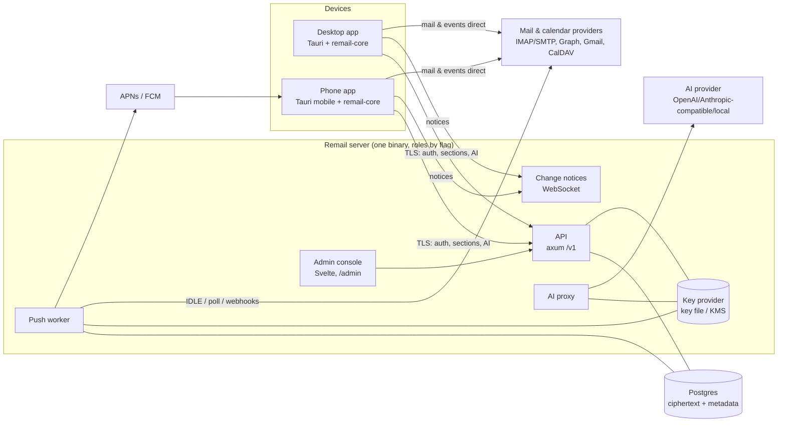
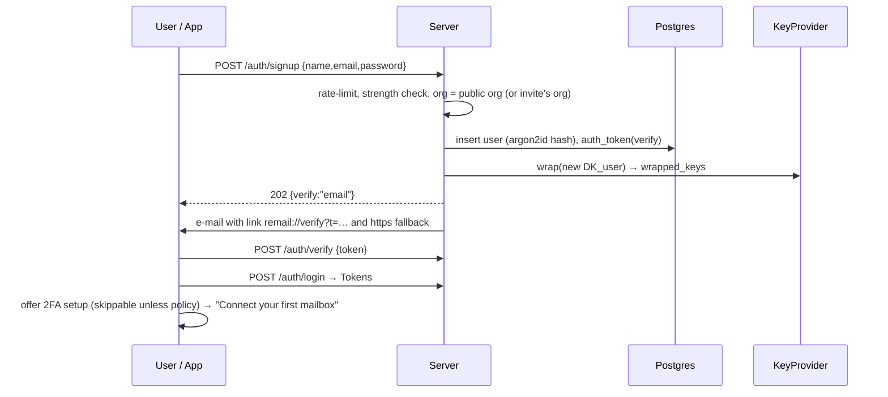
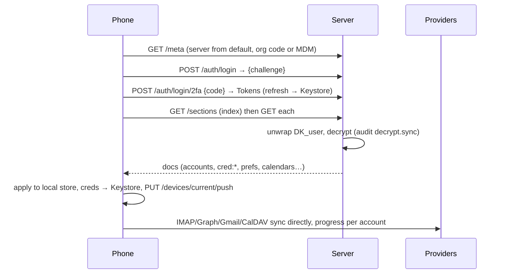
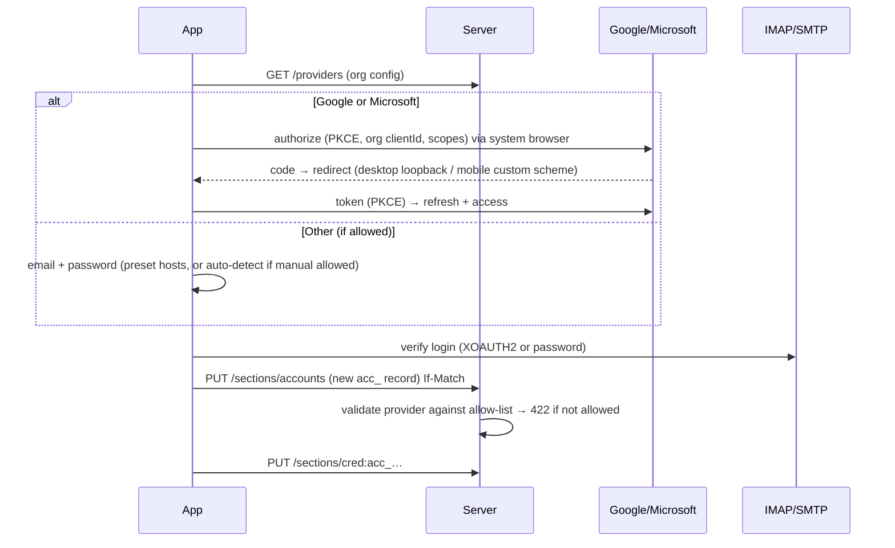
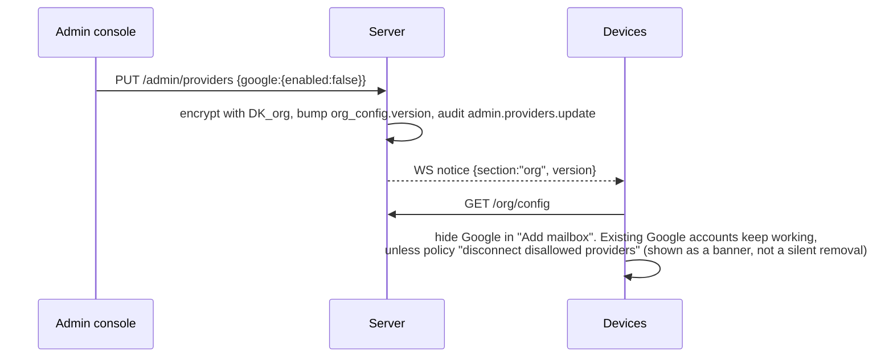
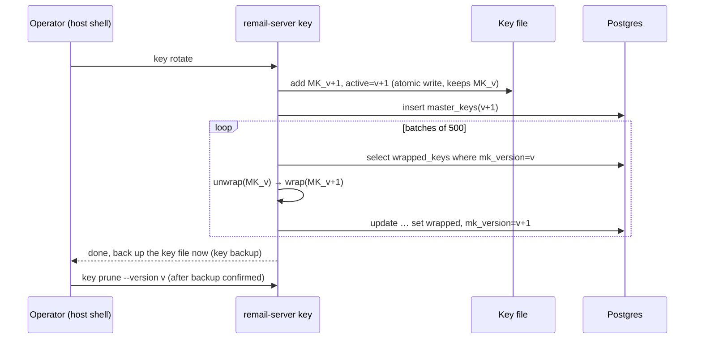
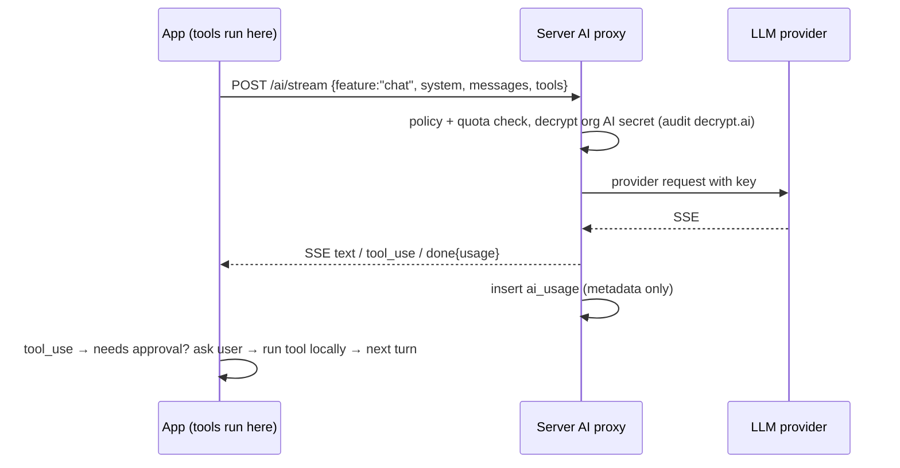
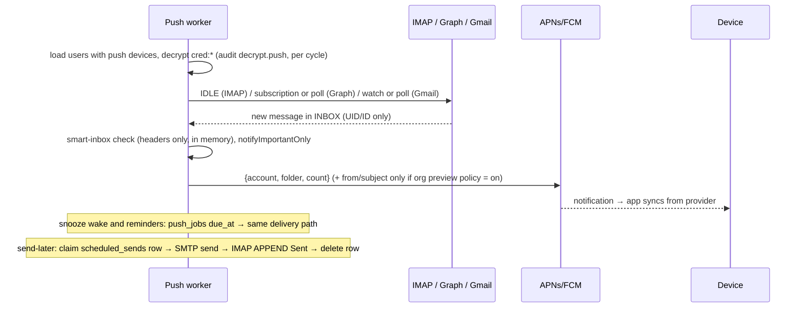
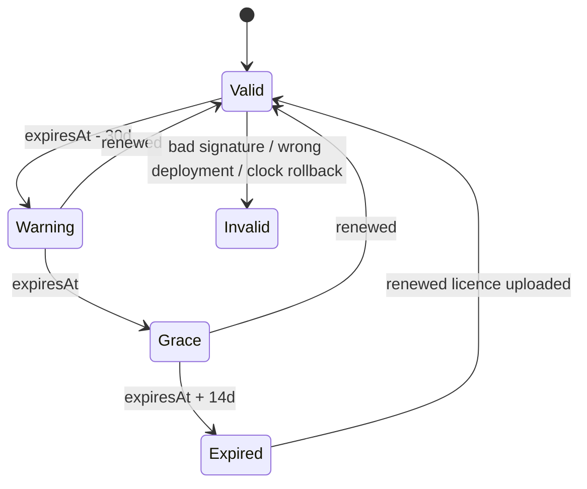

# Remail Platform: design and phased plan

Status: **draft for approval** (2026-10-21). This answers deliverables 1–3 of
[remail-platform-plan.md](../remail-platform-plan.md) and sets the shape of 4–7. Nothing here
reopens the decided points (server-held envelope encryption, AI through the server, Tauri 2 mobile).
Companion: [settings-registry.md](settings-registry.md).

---

## 1. What the code looks like today (the parts this work touches)

- **Engine** (`crates/remail-core`). `Engine::start(data_dir, Arc<dyn SecretStore>, Arc<dyn EventSink>)`
  runs per-account IMAP workers plus in-process loops: outbox (undo and send-later), snooze, AI sort,
  auto-clean and calendar.
  - Setup is stored as JSON blobs in SQLite `settings` (`app`, `ai`, `mcp`, `cal_outlook_off`) and
    in tables (`accounts`, `signatures`, `templates`, `sender_rules`, `snoozes`, `outbox`,
    `cal_accounts`, `calendars`).
  - Secrets go through the `SecretStore` trait (keyring, file and memory implementations).
- **IDs** (`acc_<uuid>`, `cal_…`, `calendar_…`) are random per install. Signatures, snoozes,
  `cal_outlook_off`, keyring entries and localStorage `sidebarHidden` all refer to them.
  **The server must become the ID authority.**
- **Provider allow-list** (`AppSettings.providers`) is checked only in `add_account` /
  `add_microsoft_account`, and only against a local value the user can edit.
- **AI.** `ai::Client::{stream, complete, list_models}` is the only code that talks to a provider. It
  has 5 call sites, all obtained through `Engine::ai_client_with`. The tool loop, approvals and
  prompts are already client-side, so swapping the transport is a contained change.
- **UI.** Svelte 5 with hash routes (`#compose=…`, `#settings=…`). There is **no i18n layer**: every
  string is an English literal. Arabic support today is bidi and RTL rendering only.
- **Mobile blockers.** The following are desktop-only:
  - the tray, `single-instance`, multi-window compose and settings;
  - the desktop features of the `keyring` crate;
  - the `libc` MCP bridge, the stdio MCP spawn, and the loopback OAuth redirect;
  - long-lived background loops.

---

## 2. Target architecture



**Principles**

1. **The device talks to providers directly.** Mail, attachments and events never pass through or
   stay on the server.
   - The one exception is send-later drafts (see §8.3 and question Q2).
2. **The server stores setup, not content.** It holds ciphertext of setup sections under per-user
   data keys.
3. **Three code paths may decrypt user data**, and each one writes an audit row:
   - `sync` (to the user's own authenticated devices);
   - `push` (the push worker);
   - `ai` (the AI proxy).

   The admin API has no route that reads `user_sections`. A test enforces this (§13).
4. **Offline-tolerant clients.** Sections are cached locally, encrypted with a device key held in
   the keychain. Mail keeps syncing directly from providers when the server is down. AI shows
   "unavailable" while the server is unreachable.
5. **One codebase, one binary.**
   - `remail-server serve` runs the API, admin console and notices.
   - `remail-server worker` runs push, schedules and the licence renewal check.
   - `REMAIL_MODE=hosted|onprem` switches multi-tenant or single-tenant.

### 2.1 Crate and package layout

```
Cargo workspace
├── crates/remail-proto     NEW  serde API types, section schemas, merge (CRDT-lite), licence format
│                                + offline verifier, i18n-neutral error codes. No IO. Used by core,
│                                server and tools.
├── crates/remail-core           + cloud/: server client (auth, section sync, local cache, notices),
│                                  ai::Backend::{Direct, Remail}, SecretStore for mobile,
│                                  Google OAuth provider, OAuth redirect abstraction
├── crates/remail-server    NEW  axum + sqlx(Postgres). Modules: auth, totp, sessions, devices, orgs,
│                                sections, crypto (envelope, KeyProvider), ai_proxy, push, schedule,
│                                licence, admin, audit, ratelimit, mailer, notices, i18n (emails).
│                                Binary subcommands: serve | worker | migrate | key (init, rotate,
│                                backup, verify, prune) | org (create) | user (invite-admin)
├── tools/remail-licensor   NEW  Owner-only CLI: keygen, issue, renew, revoke, customers (local
│                                SQLite ledger). The signing key is never in the repo.
├── src-tauri                    desktop + mobile shell (cfg(desktop) / cfg(mobile) split)
├── src/                         Svelte app; + lib/i18n, + auth/ screens, + mobile/ screens
├── admin/                  NEW  Svelte admin console (own Vite entry, imports ../src/lib for
│                                i18n, Select, bidi). Built into the server image, served at /admin.
└── deploy/                 NEW  docker-compose.yml, Caddyfile, .env.example, docs/ (install,
                                 keys, backup/restore, upgrade, air-gapped, no-push)
```

**Library choices** (vetted libraries only):

| Need | Library |
|---|---|
| Password hashing | `argon2` (argon2id, m=64 MiB, t=3, p=1) |
| Encryption | `aes-gcm` |
| Licence signatures | `ed25519-dalek` |
| Random numbers | `rand` (OS RNG) |
| TOTP | `totp-rs` |
| Database | `sqlx` (Postgres, compile-time-checked queries, migrations) |
| Web | `axum` and `tower-http` |
| Rate limits | `tower_governor` |
| Push | `a2` (APNs) and `fcm_v1`, or plain HTTP v1 |
| Server mail | `lettre` |

---

## 3. Phased plan (milestones)

Each milestone ends with green `cargo test`, `cargo clippy -- -D warnings`, `pnpm check` and
`pnpm test`, plus a local `.deb` build of the desktop app.

| # | Milestone | Ships | Done when |
|---|---|---|---|
| **M0** | Foundations | `remail-proto`, `remail-server` skeleton (config, migrations, health, `/v1/meta`), envelope crypto and key file tooling, dev `docker-compose` (Postgres), **i18n layer** (`t()` with `en`/`ar` catalogs, `dir`/`lang` on `<html>`), CI jobs | Envelope round-trip and rotation tests pass. `t()` is used by every new screen. |
| **M1** | Accounts + sign-in gate | Sign-up, verification e-mail (hosted) or invite (on-prem), sign-in, TOTP and backup codes, refresh rotation, devices, password reset (e-mail or admin), rate limits and lockout. Client: server address / org code, first-run Create / Sign in screens, the gate, keychain session, Settings → Account. | The desktop app is unusable signed out. Sign up, sign in, 2FA, sign-out-device and reset work end to end against a local server. |
| **M2** | Server-stored settings | Sections API with versions and `If-Match`, WS notices and polling fallback, client sync engine and merge, local encrypted cache. Migration of today's local setup on first sign-in. Accounts and credentials sync: **sign in on a second desktop and everything comes down**. Provider list from org config, allow-list enforced server-side, **Google OAuth**, Settings → Admin removed. | Sync-conflict tests (§13) pass. A second profile signs in and syncs mail with progress shown. |
| **M3** | Admin console | Org, providers, users, policies, security, audit pages (EN/AR). Owner view for hosted (orgs list). Invite flow. | All admin actions are audited. The "no admin endpoint returns user data" test passes. |
| **M4** | AI proxy | `/v1/ai/*`, org AI config and key (write-only), policies and limits, metadata-only usage log. Client `ai::Backend::Remail`, AI settings reduced to user prefs. | The key never appears in any client response or log (test). No bodies are stored (test). The assistant tool loop works through the proxy. |
| **M5** | Push worker + server schedules | Worker: IMAP IDLE / polling, Graph change notifications (polling fallback), Gmail `watch` (polling fallback), snooze wake, send-later on the server, calendar reminders. APNs/FCM and desktop WS delivery. Org preview policy. | Send-later and snooze fire with every device off (GreenMail e2e). Payloads carry no content unless the policy allows it. |
| **M6** | Mobile | Tauri mobile targets. Single-pane list → thread → compose, calendar agenda/day, sign-in, Settings (Account, Accounts, General). Keychain/Keystore `SecretStore`. Custom-scheme OAuth redirect. Push registration. Background fetch. | It builds in CI on macOS (iOS) and Linux (Android). See the limitations in §15. |
| **M7** | On-prem bundle + licensing | Licence format, verifier, enforcement (warn / grace / block), clock-rollback and deployment binding, `remail-licensor`, compose bundle with Caddy, install / keys / backup / upgrade / air-gapped docs, MDM config keys, branded-build switch. | Tampered, expired and wrong-deployment licence tests pass. A fresh `docker compose up` on a clean VM, with no internet except the mail provider, works. |

**Order and dependencies.**
- M0 → M1 → M2 is strictly sequential.
- M3 and M4 can proceed in parallel after M2.
- M5 needs M2 (credentials on the server).
- M6 needs M1 and M2, and benefits from M5.
- M7's licence **verifier** is built in M1, because "no new sign-ins after grace" lives in the auth
  path. The generator and bundle come in M7.

---

## 4. Encryption (envelope, admin-managed)

```
Master key  MK_v (32 B)  ── in the key file (0600, outside the DB) or KMS; never in Postgres
   │ wraps (AES-256-GCM, AAD = "remail/dk/v1|<org_id>|<owner_id>|mk<v>")
   ▼
Data keys   DK_user (32 B random, one per user)   DK_org (one per org, for org config + secrets)
   │ encrypts (AES-256-GCM, 96-bit random nonce, AAD = "remail/sec/v1|<owner_id>|<section>|<version>")
   ▼
Section blobs  user_sections.ciphertext, org_config.ciphertext, org_secrets.ciphertext
```

- **The key file** (`/etc/remail/master.key`, outside the database volume) holds a small keyring, so
  that rotation never strands data:
  `{"deployment":"dep_…","active":2,"keys":{"1":"base64…","2":"base64…"}}`.
- **`KeyProvider` trait:** `wrap(org, dk) -> (mk_version, blob)` and `unwrap(org, mk_version, blob)`.
  - `FileKeyProvider` is used on-prem and in dev.
  - `KmsKeyProvider` is used for hosted: AWS KMS with one CMK per org via `key_id` per org row. It is
    behind a cargo feature. HSM via PKCS#11 comes later through the same trait.
- **Nonce and AAD.** Every write uses a fresh random nonce. The AAD binds the ciphertext to its
  owner, section and version, so a database-level row swap fails to decrypt.
- **Unwrapped DKs** are cached in memory for 5 minutes and zeroized on drop (`zeroize`).
- **Rotation** (`remail-server key rotate`):
  1. Generate MK_{v+1} into the key file and set it active.
  2. A batched job re-wraps every `wrapped_keys` row from v to v+1. Data is **not** re-encrypted.
  3. Progress shows in Admin → Security.
  4. When no rows reference v, `key prune` removes v after a confirmation and a reminder to back up
     the new file first.
- **Backup** (`key backup --out FILE`): writes the key file encrypted with a passphrase. The
  passphrase is stretched with argon2id and the file is sealed with AES-GCM.
  - The console records `last_key_backup_at` and nags after rotation, or every 90 days.
  - Docs state plainly that **losing both the key file and its backup loses every user's settings
    and credentials**. Mail at the providers is unaffected, and users would re-add mailboxes.
- **Device-side cache.**
  - Sections are cached in the local SQLite `cloud_sections` table, AES-GCM encrypted with
    `remail-cache-key` from the OS keychain or keystore.
  - Provider credentials stay in the keychain as today.
  - A wiped keychain means the device re-downloads.

---

## 5. Sync

### 5.1 Sections

| Section id | Contents | Owner |
|---|---|---|
| `prefs` | App preferences, AI user prefs, `sidebarHidden`, `lastComposeAccount`, language | user |
| `shortcuts` | Bindings per action | user |
| `accounts` | Mail account records (no secrets) | user |
| `calendars` | Calendar accounts, subscriptions, overrides, `calendar_prefs`, `outlookOff` | user |
| `signatures`, `templates`, `sender_rules`, `snoozes` | Records | user |
| `cred:<acc_…\|cal_…>` | One per credential: password, or Grant `{provider, clientId, refreshToken, subject}` | user |
| `org` | Public org config: providers, presets, policies, branding, AI features (no secrets) | org (read-only to clients) |

Credentials get their own sections so that a **token refresh never touches the settings that a user
is editing**. A device that rotates a refresh token writes only `cred:<id>`. That write cannot
conflict with an edit to `accounts`.

### 5.2 Document model (in `remail-proto`)

```rust
struct SectionDoc { records: BTreeMap<String /*record id or "_"*/, Record> }
struct Record {
    fields: BTreeMap<String, Lww>,       // scalars and structs: last-write-wins
    sets:   BTreeMap<String, OrSet>,     // lists: set-union with tombstones
    deleted: Option<Stamp>,              // record tombstone (30 days)
}
struct Lww   { value: serde_json::Value, at: Stamp }
struct OrSet { adds: BTreeMap<String /*item*/, Stamp>, removes: BTreeMap<String, Stamp> }
struct Stamp { ms: i64, device: String } // ordered by (ms, device); a total order, so ties are deterministic
```

- **`merge(a, b)`** is commutative, associative and idempotent. The server never merges: clients
  merge and retry, and the CRDT properties guarantee convergence.
- **Delete vs edit.** A record tombstone wins over field edits stamped before it. An edit after the
  tombstone resurrects the record.
  - Example: an account was removed on device A, and offline device B renames it with an earlier
    timestamp. The account stays removed.
- **Garbage collection.** Tombstones older than 30 days are dropped on write. A device that was
  offline longer than 30 days does a full reset of that section (server wins). The UI says so once.
- **Clock skew.** Device clocks are not trusted blindly. The client stamps with
  `max(local_now, last_server_time_seen + 1)`.

### 5.3 Protocol

```
GET  /v1/sections                       → [{id, version, updatedAt}]             (index; cheap)
GET  /v1/sections/{id}                  → 200 {version, doc} + ETag: "v<version>"
PUT  /v1/sections/{id}  If-Match: "v7"  {doc} → 200 {version: 8} | 412 {version, doc} (current)
WS   /v1/notices  (after auth msg)      ← {"section":"accounts","version":8}  (no content)
```

- **Client loop.**
  1. A local change marks a section dirty.
  2. The client merges into the cached doc and PUTs with `If-Match`.
  3. On 412 it merges the returned doc, then PUTs again (up to 5 times, with jitter).
  4. Notices or polling (every 60 s with WS, every 5 min without; mobile polls on resume) trigger a
     GET when the version is newer.
- **Applying to the engine.** The sync layer writes the merged doc into the existing local tables
  and settings keys. **The engine keeps reading SQLite as it does today**, so most engine code is
  untouched.
  - A single `cloud::apply(section)` maps each section to the store.
  - A store hook marks a section dirty when local code writes those tables.
- **Server-side validation on PUT.** This runs inside the `sync` decryption path:
  - schema;
  - size caps (256 KiB per section, 2 MiB per user);
  - **provider allow-list**: each `accounts` record's `provider` and `imap/smtp` hosts must be
    allowed by the org config. Otherwise the server returns 422 `provider_not_allowed`.

---

## 6. Database schema (Postgres)

```sql
create table orgs (
  id text primary key,                       -- org_<uuid>
  name text not null,
  slug text unique not null,                 -- org code
  signup_mode text not null default 'invite',-- open | invite | sso (later)
  allowed_domains text[] not null default '{}',
  kms_key_id text,                           -- hosted: per-org CMK
  disabled_at timestamptz,
  created_at timestamptz not null default now()
);

create table users (
  id text primary key,                       -- usr_<uuid>
  org_id text not null references orgs(id),
  email citext not null,
  name text not null,
  role text not null default 'user',         -- owner | admin | user
  password_hash text not null,               -- argon2id PHC string
  email_verified_at timestamptz,
  totp_secret_enc bytea,                     -- encrypted with DK_org (auth data, not user data)
  totp_enabled_at timestamptz,
  disabled_at timestamptz,
  failed_logins int not null default 0,
  locked_until timestamptz,
  last_active_at timestamptz,                -- seat counting (active in the last 30 days)
  created_at timestamptz not null default now(),
  unique (org_id, email)
);
create unique index users_email_hosted on users (email);  -- hosted: e-mail unique across orgs

create table backup_codes (user_id text references users(id) on delete cascade,
  code_hash text not null, used_at timestamptz, primary key (user_id, code_hash));

create table devices (
  id text primary key,                       -- dev_<uuid>
  user_id text not null references users(id) on delete cascade,
  name text not null, platform text not null,-- linux|windows|macos|ios|android
  app_version text, push_kind text, push_token_enc bytea,
  created_at timestamptz not null default now(), last_seen_at timestamptz,
  revoked_at timestamptz
);

create table sessions (
  id text primary key,                       -- ses_<uuid>
  device_id text not null references devices(id) on delete cascade,
  family text not null,                      -- refresh-token family (reuse ⇒ revoke family)
  refresh_hash bytea not null unique,        -- SHA-256 of the opaque refresh token
  access_hash bytea unique, access_expires_at timestamptz,
  expires_at timestamptz not null, rotated_at timestamptz, revoked_at timestamptz
);

create table auth_tokens (                   -- email verification, password reset, invites, 2FA challenge
  hash bytea primary key, kind text not null, user_id text, org_id text not null,
  email citext, role text, expires_at timestamptz not null, used_at timestamptz
);

create table master_keys (version int primary key, fingerprint text not null,
  created_at timestamptz not null default now(), retired_at timestamptz);

create table wrapped_keys (
  owner_kind text not null,                  -- user | org
  owner_id text not null,
  org_id text not null references orgs(id),
  mk_version int not null references master_keys(version),
  wrapped bytea not null,                    -- nonce || ciphertext || tag
  primary key (owner_kind, owner_id)
);

create table user_sections (
  user_id text not null references users(id) on delete cascade,
  section text not null,
  version bigint not null,
  ciphertext bytea not null,
  updated_at timestamptz not null default now(),
  updated_by text,                           -- device id
  primary key (user_id, section)
);

create table org_config  (org_id text primary key references orgs(id), version bigint not null,
  ciphertext bytea not null, updated_at timestamptz not null default now());
create table org_secrets (org_id text primary key references orgs(id), version bigint not null,
  ciphertext bytea not null, updated_at timestamptz not null default now());

create table scheduled_sends (                -- server send-later (M5)
  id text primary key, user_id text not null references users(id) on delete cascade,
  account_id text not null, send_at timestamptz not null,
  ciphertext bytea not null,                 -- draft MIME/JSON incl. attachments, DK_user
  status text not null default 'pending', attempts int not null default 0,
  last_error_code text, claimed_by text, claimed_at timestamptz
);
create table push_jobs (                      -- snooze wake, reminders (ids + times only)
  id bigserial primary key, user_id text not null, kind text not null,
  due_at timestamptz not null, ref text not null, done_at timestamptz);

create table ai_usage (                       -- metadata only, never bodies
  id bigserial primary key, org_id text not null, user_id text not null, feature text not null,
  model text not null, input_tokens int, output_tokens int, ms int, status text,
  at timestamptz not null default now());

create table licences (id text primary key, raw text not null, customer text not null,
  seats int not null, features text[] not null, starts_at date not null, expires_at date not null,
  installed_at timestamptz not null default now(), active boolean not null default true);
create table deployment (id text primary key, mode text not null,
  last_seen_clock timestamptz not null, clock_mac bytea not null); -- HMAC(DK_org-derived) of last_seen_clock

create table audit_log (
  id bigserial primary key, at timestamptz not null default now(),
  org_id text, actor_kind text not null,     -- user | admin | owner | system
  actor_id text, action text not null,       -- e.g. admin.user.disable, decrypt.sync, decrypt.push
  target text, ip inet, meta jsonb not null default '{}'   -- never secrets or content
);
create index on audit_log (org_id, at desc);
```

**Audit volume.** Decrypt-path auditing is aggregated:
- `decrypt.sync` gets one row per device per 10 minutes, with a count;
- `decrypt.push` gets one row per worker cycle per user;
- `decrypt.ai` gets one row per request.

Without this, every sync poll would flood the log.

---

## 7. API (v1)

All bodies are JSON with camelCase keys. Errors look like `{"error":{"code":"…","message":"…"}}`.
Codes are stable, and clients translate them through `t("err.<code>")`.
Auth uses `Authorization: Bearer <access>`. Access tokens last 15 minutes. Refresh tokens last 30
days, sliding, capped by the org's session policy.

### 7.1 Discovery and meta
| Method | Path | Response |
|---|---|---|
| GET | `/v1/meta` | `{mode, version, minClient, orgName?, branding?, signup: "open"\|"invite", licence: {state}}` |
| GET | `/v1/orgcode/{code}` (hosted directory) | `{server: "https://mail.acme.com"}` |

### 7.2 Auth
| Method | Path | Request → Response |
|---|---|---|
| POST | `/v1/auth/signup` | `{name, email, password, invite?, locale}` → `202 {verify: "email"\|"none"}`. Password check: zxcvbn score ≥ 3 and length ≥ 10. |
| POST | `/v1/auth/verify` | `{token}` → `204` |
| POST | `/v1/auth/login` | `{email, password, device: {name, platform, appVersion}}` → `200 Tokens` or `200 {challenge, methods:["totp","backup"]}` |
| POST | `/v1/auth/login/2fa` | `{challenge, code}` → `Tokens` |
| POST | `/v1/auth/refresh` | `{refreshToken}` → `Tokens` (rotating; reuse revokes the family) |
| POST | `/v1/auth/logout` | → `204` (this device) |
| POST | `/v1/auth/reset/request` | `{email}` → `202` (always; hosted only) |
| POST | `/v1/auth/reset` | `{token, password}` → `204`. Revokes all sessions. |
| GET | `/v1/me` | `{id, name, email, role, orgId, totp: bool, policies}` |
| PATCH | `/v1/me` | `{name?}` |
| POST | `/v1/me/password` | `{current, new}` → `204`. Revokes other sessions. |
| POST | `/v1/me/2fa/setup` | → `{secret, otpauthUrl}` |
| POST | `/v1/me/2fa/enable` | `{code}` → `{backupCodes: [10 × "xxxx-xxxx"]}` |
| POST | `/v1/me/2fa/disable` | `{password, code}` → `204` (refused if the org requires 2FA) |
| GET | `/v1/me/devices` | `[{id, name, platform, lastSeenAt, current}]` |
| DELETE | `/v1/me/devices/{id}` | → `204` (revokes its sessions and push token) |
| PUT | `/v1/me/devices/current/push` | `{kind: "apns"\|"fcm"\|"none", token}` |

`Tokens = {accessToken, accessExpiresAt, refreshToken, deviceId, user: Me}`.

### 7.3 Sections, org config, providers
| Method | Path | Notes |
|---|---|---|
| GET/PUT | `/v1/sections[/{id}]` | §5.3 |
| GET | `/v1/org/config` | Public org config. Clients cache it as section `org`. |
| GET | `/v1/providers` | `[{kind: "google"\|"microsoft"\|"imap", enabled, oauth?: {clientId, tenant, scopes, authority}, presets?: [{name, domain, imap, smtp, caldav}]}]` |
| POST | `/v1/providers/google/token` | Code exchange through the server, **only if** the org configured a Google client secret (Google "Web" client type). Otherwise the client does PKCE directly with an installed-app client. |
| POST | `/v1/providers/google/refresh` | `{refreshToken}` → `GoogleTokens`. Same condition: a "Web" client can't refresh without its secret, so clients whose org has `serverExchange` refresh here. Audited, rate-limited per user; tokens never logged. |

### 7.4 AI proxy
| Method | Path | Request → Response |
|---|---|---|
| GET | `/v1/ai/status` | `{enabled, features: ["summarize","reply","compose","rewrite","chat","sort"], models: [..], defaultModel, remaining?: {requests, tokens}}` |
| POST | `/v1/ai/stream` | `{feature, model?, system, messages: [Message], tools?: [ToolDef], maxTokens?}` → `text/event-stream` with events `text {delta}`, `tool_use {id,name,input}`, `done {stopReason, usage}`, `error {code}` |

`Message` and `ToolDef` are the provider-neutral types that already exist in `remail-core::ai`. They
move to `remail-proto`. The server owns the provider URL, key, and the OpenAI/Anthropic body
translation (the existing `openai_body` / `anthropic_body` / SSE parsing move into a shared module
that the server uses).

### 7.5 Admin (role `admin` for their own org, `owner` for any org)
| Method | Path | Notes |
|---|---|---|
| GET/PATCH | `/v1/admin/org` | name, branding (logo upload ≤ 256 KiB), allowed domains, sign-up mode |
| GET/PUT | `/v1/admin/providers` | toggles, Microsoft `{clientId, tenant}`, Google `{clientId, clientSecret?}` (secret write-only), presets |
| GET/PUT | `/v1/admin/ai` | `{provider, baseUrl, model(s), apiKey?}`. Responses carry `{hasKey: true, keyHint: "…a1b2"}`, never the key. |
| GET/PUT | `/v1/admin/policies` | `{require2fa, sessionDays, platforms[], notificationPreview, deviceCacheDays, ai: {enabled, features[], monthlyTokensPerUser, monthlyRequestsPerUser}, mcp: {enabled}}` |
| GET | `/v1/admin/users?query&cursor` | `[{id, name, email, role, status, totp, devices, lastActiveAt}]` (**account metadata only**) |
| POST | `/v1/admin/users/invite` | `{email, name?, role}` → `{inviteUrl}` (also e-mailed when SMTP is set) |
| POST | `/v1/admin/users/{id}/disable` / `enable` | — |
| POST | `/v1/admin/users/{id}/reset-password` | → `{resetUrl}` (one-time, 24 h). Data stays intact and unseen. |
| POST | `/v1/admin/users/{id}/reset-2fa` | — |
| GET | `/v1/admin/users/{id}/devices` | Device metadata |
| DELETE | `/v1/admin/users/{id}/devices/{dev}` | — |
| GET | `/v1/admin/usage` | Seats, AI usage aggregates |
| GET | `/v1/admin/security` | `{masterKey: {version, fingerprint, createdAt, rotation: {state, done, total}}, lastBackupAt}` |
| POST | `/v1/admin/security/backup-confirmed` | Records a backup acknowledgement (the backup itself is CLI, on the host) |
| GET | `/v1/admin/licence` | `{state: valid\|warning\|grace\|expired\|invalid, customer, seats, used, features, expiresAt, graceEndsAt}` |
| PUT | `/v1/admin/licence` | `text/plain` licence → same |
| GET | `/v1/admin/audit?cursor&action` | Audit rows |
| GET/POST | `/v1/owner/orgs` | Hosted owner only |

Key rotation is a host CLI action (`remail-server key rotate`) on purpose: whoever can rotate the
master key already holds the host. The console shows its status.

---

## 8. Key flows (sequence diagrams)

### 8.1 Sign-up (hosted)

On-prem uses the same flow, except `invite` is required and the e-mail is pre-filled from the invite.

### 8.2 Sign-in on a new phone


### 8.3 Connect Google / Microsoft / IMAP

A record ID is minted client-side (`acc_<uuid>`, UUIDs don't collide). The server's accept is what
makes it canonical. On first sign-in after an upgrade, local accounts are uploaded with their
existing IDs. A second device never invents IDs for synced accounts.

### 8.4 Admin changes a provider setting


### 8.5 Master-key rotation


### 8.6 AI request


### 8.7 Push notification


### 8.8 Licence expiry


| State | Effect |
|---|---|
| Warning | Banner in the console. E-mail to admins weekly. |
| Grace | Console banner on every page. Clients still work. |
| Expired | `login` and new device registration return `licence_expired`. Existing sessions keep refreshing, so sync, settings, AI and export keep working. Admins can still sign in to upload a licence. |
| Over seats | `signup`/`invite` returns `seat_limit`. Existing users are unaffected. |

### 8.9 On-prem install
```mermaid
sequenceDiagram
  participant IT as Customer IT
  participant H as Host
  participant C as Compose bundle
  IT->>H: unpack bundle, cp .env.example .env (domain, SMTP optional)
  IT->>C: docker compose run --rm server key init  → /etc/remail/master.key
  IT->>C: docker compose run --rm server key backup --out /backup/remail-key.enc
  IT->>C: docker compose up -d (postgres, server, worker, caddy)
  C->>C: migrate, create deployment id, print one-time admin invite URL
  IT->>C: open invite → create admin → upload licence (bound to deployment id)
  IT->>IT: configure providers, AI, policies; invite users; publish org code or MDM config
```
The deployment ID is shown before purchase, so the licence can be issued for it.

---

## 9. Licence format

```
REMAIL-LICENCE-1.<base64url(payload JSON)>.<base64url(Ed25519 signature over "REMAIL-LICENCE-1." + payload b64)>
payload = { "lid":"lic_…", "customer":"Acme Ltd", "deployment":"dep_…", "seats":250,
            "features":["ai","mcp","calendar","push"], "starts":"2026-11-01", "expires":"2027-10-31",
            "issued":"2026-10-21T10:00:00Z", "renewUrl":"https://…" (optional) }
```

- **Verification** (`remail-proto::licence::verify(raw, &[PublicKey], deployment, now)`):
  1. Check the signature against embedded public keys. A list allows issuer-key rotation.
  2. Check that the deployment ID matches.
  3. Check that `starts <= now`.
  4. Return the state.
- **Clock-rollback detection.**
  - The server keeps `deployment.last_seen_clock` (monotonic max of observed wall-clock, updated
    hourly). It is MAC'd with a key derived from DK_org, so it can't be edited in SQL.
  - If `now < last_seen_clock - 24h`, the state is `invalid(clock)` until the clock is fixed.
  - Postgres `now()` is also cross-checked.
- **Online check.** Optional and on by default for hosted, off for air-gapped. It does
  `GET renewUrl?lid=` and accepts a newer signed licence or a signed revocation.
- **Generator** (`tools/remail-licensor`, owner only):
  - Commands: `keygen` (the private key goes to a file you keep offline), `issue`, `renew`,
    `revoke` (writes a signed revocation for the online check), and `customers` (a local SQLite
    ledger).
  - The issuer's public key is compiled into the server through `REMAIL_LICENCE_PUBKEYS` at build
    time.

---

## 10. Client changes

1. **Gate.**
   - `App.svelte` gets a new top state: `server?` → `signedIn?` → `setupDone?`.
   - Without a session it shows the auth screens only: welcome (Create / Sign in), server or org
     code (behind "Using Remail at work?"), sign-up, verify, 2FA, connect first mailbox, and
     "Setting up your mailboxes" progress.
   - The engine starts per-account workers only after sign-in. Before that,
     `Engine::start_locked` runs with no workers.
2. **Session.**
   - `cloud::Session` lives in remail-core and is stored in `SecretStore` under `remail-session`.
   - The access token is refreshed in Rust and never exposed to the webview.
   - All server calls are Rust commands, so the CSP stays `connect-src 'self' ipc:`.
3. **Sync.** `cloud::Sync` applies sections to the existing store (§5.3).
   - Engine-side setters (`set_settings`, `update_account_prefs`, `save_template`, …) call
     `cloud.mark_dirty(section)`.
   - localStorage `shortcuts`, `sidebarHidden` and `lastComposeAccount` move behind commands that
     read and write `prefs`/`shortcuts`. Device-only keys stay in localStorage.
4. **Providers.** `AccountSetup.svelte` reads `/v1/providers` instead of `AppSettings.providers`.
   - The Microsoft "enter your app ID" panel is deleted.
   - Google OAuth is added: `oauth::Provider::google(client_id)` with scopes
     `https://mail.google.com/`, `https://www.googleapis.com/auth/calendar` and `openid email`.
     Gmail IMAP/SMTP uses XOAUTH2, and calendars use Google CalDAV with the bearer token. Google
     Calendar API sync is not needed in v1.
5. **AI.** `ai::Client` gets `Backend::Remail { cloud }`.
   - `AiSettings.svelte` shrinks to user prefs: on/off (if the org allows it), instructions, smart
     sort, and a model picker from `/v1/ai/status`.
   - The keyring `ai-api-key` is deleted on migration.
6. **Settings.**
   - Remove the `admin` section and `providers` / `microsoftClientId` from the client.
   - Add **Account**: profile, password, 2FA, devices, sign out.
   - Add **Language** (English / العربية) in General.
7. **i18n.** `src/lib/i18n.svelte.ts` provides `t(key, vars)`, `locale`, and `en.json` / `ar.json`.
   - It sets `<html lang dir>`, and layouts switch to logical CSS properties.
   - New screens are translated from day one. Translating **the existing app's** ~1,000 strings is
     milestone work (question Q3).
8. **Mobile** (M6). Under `#[cfg(desktop)]` go the tray, single-instance, compose and settings
   windows, MCP, and the libc bridge. Mobile gets:
   - a `mobile/` Svelte shell: list → thread → compose as routes in one window, and calendar
     agenda/day;
   - `KeystoreSecretStore` (iOS Keychain / Android Keystore, via a small Tauri plugin or the
     `keyring` iOS backend plus an Android plugin);
   - an OAuth redirect `app.remail://oauth` through the deep-link plugin;
   - background fetch through the platform scheduler. Sync on push. Snooze and send-later are
     server-side.

---

## 11. Admin console screens (functional)

All screens are in English and Arabic (RTL) and use shared `Select` and `t()`. Every mutation shows
a confirmation and writes audit.

- **Sign-in:** the same auth as users, `role ∈ {admin, owner}`, 2FA required for admins (always).
- **Overview:** seats used/allowed, licence state, key backup age, AI usage this month.
- **Organisation:** name, logo, allowed e-mail domains, sign-up mode, org code.
- **Email providers:**
  - Google, Microsoft and Other toggles;
  - Microsoft client ID and tenant;
  - Google client ID, plus a secret (write-only);
  - preset servers table (name, domain, IMAP, SMTP, CalDAV);
  - "allow manual servers".
- **AI:** provider (OpenAI-compatible / Anthropic-compatible / local URL), base URL, models, key
  (write-only, "Replace key"), feature toggles, monthly limits, usage table (per user: requests and
  tokens, no content).
- **Users:** search, invite, role, disable/enable, reset password (shows a one-time link), reset
  2FA, devices list with sign-out, last active. **No column or drawer shows mailboxes, settings or
  content.**
- **Policies:** require 2FA, session lifetime, allowed platforms, notification previews, device
  cache retention, MCP on/off.
- **Security:** master key version, fingerprint, rotation progress, last backup, CLI instructions.
- **Licence:** state, customer, seats, features, expiry, upload.
- **Audit log:** filter by action or actor, decrypt paths included.
- **Owner (hosted):** orgs list, create org, and per-org drill-down into the same pages.

---

## 12. Threat model

| Scenario | Exposed | Not exposed | Mitigations |
|---|---|---|---|
| **Database-only leak** (backup stolen, SQL injection read) | Org and user metadata: names, e-mails, roles, device names, last-active, audit rows, AI usage counts, argon2 hashes, licence | Settings, mailbox list, provider credentials, AI key, TOTP secrets (all AES-GCM under DKs wrapped by an MK that isn't in the DB). Mail (never on the server). | The key file lives outside the DB volume and its backups. Argon2id slows offline cracking. Backup docs keep DB and key backups apart. |
| **Full server compromise** (DB + master key + running process) | Everything the server can decrypt: every user's settings and **provider refresh tokens and passwords**, the AI key. Through those tokens, an attacker can read mail at the providers until tokens are revoked. | Past mail isn't on the server, but it is reachable through the tokens. Device caches. | Inherent to server-held keys (decided). Limits: KMS/HSM for hosted so the MK can't be copied off; audit and alerts on decrypt volume; incident runbook (rotate MK, force re-auth of all provider grants, revoke sessions). Documented honestly. |
| **Malicious org admin** (console only) | Users' names, e-mails, devices, activity times, AI usage counts. Can disable users, reset passwords and sign out devices. | **No API returns user sections.** A password reset doesn't reveal data. The admin can't read keys from the console. | Route-level test that no admin endpoint touches `user_sections`. Audit of every admin action, visible to the owner (hosted). Separate roles. |
| **Malicious org admin with host root** (on-prem) | Same as full server compromise for their org | — | Out of scope by design: on-prem means the customer's IT runs the keys. Documented in the sales and install docs. |
| **Stolen unlocked phone or laptop** | Whatever the signed-in app shows: mail, settings, and provider tokens in the keychain (usable while unlocked) | The server password. The TOTP seed. Other users. | "Sign out this device" (user or admin) revokes the server session and push token at once. The device then wipes its cache and credentials on next contact. Provider tokens should also be revoked at Google/Microsoft (a link in the UI). Device cache retention policy. OS-level disk encryption is assumed. |
| **Stolen locked device** | Nothing readable without the OS unlock | — | Keychain/Keystore items use `WhenUnlocked` / `setUserAuthenticationRequired(false)` but device-bound. The cache key is in the keychain. |
| **Network attacker** | — | — | TLS only (clients refuse `http://` except `localhost` in debug). Optional certificate pinning for branded builds. |
| **Credential stuffing / brute force** | — | — | Per-IP and per-account limits, progressive lockout (5 fails → 1 min, doubling, max 1 h), 2FA, identical responses for unknown e-mails. |

**Logging rules.** `tracing` fields never include secrets or bodies. A `Redacted<T>` wrapper is used
for tokens and keys. The AI proxy logs only usage. The MCP server output already strips secrets;
`tests/assistant.rs` covers that. Crash reports (if added later) go through the same redaction.

---

## 13. Tests (mapped to deliverable 7)

| Area | Test | Where |
|---|---|---|
| Envelope | Round trip, wrong AAD fails, nonce uniqueness, rotate v1→v2 then decrypt everything, prune refuses while rows reference v | `remail-server` unit + `tests/keys.rs` (Postgres) |
| Admin isolation | (a) Static: walk the admin router's handlers, assert none links `sections::` or `crypto::decrypt_user`. (b) Dynamic: seed a user with marker strings in every section, call **every** admin route, assert no marker and no ciphertext in any response. | `tests/admin_isolation.rs` |
| Licence | Valid; tampered payload; tampered signature; wrong deployment; expired → grace → expired transitions with an injected clock; clock rollback; seat limit blocks new, not existing | `remail-proto` unit + `tests/licence.rs` |
| Sync conflicts | Two devices edit offline (different fields merge, same field LWW by stamp); account removed while another device edits offline (tombstone wins); token refresh writes `cred:` while a settings edit races `accounts` (both survive, no 412 loop); tombstone GC after 30 days → full reset | `remail-proto` property tests (proptest: merge commutative/associative/idempotent) + `tests/sync.rs` |
| Allow-list | PUT `accounts` with a disallowed provider → 422. A direct API call (no UI) is refused. | `tests/providers.rs` |
| AI proxy | Mock LLM records requests. Client responses and server logs never contain the key or URL. `ai_usage` has no body columns. Bodies absent from logs (capture the tracing subscriber). Quota enforced. | `tests/ai_proxy.rs` |
| Auth | Sign-up → verify → login → 2FA → refresh rotation → reuse detection revokes the family → device sign-out → reset revokes sessions. Lockout timing. | `tests/auth.rs` |
| E2E | Server (test Postgres via docker) + GreenMail + Radicale + mock Microsoft IdP (`REMAIL_MS_AUTHORITY`): sign up, connect IMAP (GreenMail) and Microsoft (mock), second "device" (fresh engine) signs in and syncs mail; send-later fires from the worker with the engine stopped | `crates/remail-core/tests/platform_e2e.rs`, gated by `REMAIL_PLATFORM_IT=1` |
| UI | `i18n` (all keys in both catalogs, no missing `ar`), gate state machine, sign-up form validation | vitest |

Postgres for tests: a throwaway container (`scripts/test-postgres.sh`, like `test-server.sh`) on a
free port, so it never touches the machine's existing databases.

---

## 14. Migration of existing desktop installs

The first launch after the update shows the sign-in gate. After sign-in, if the local store has
accounts and the server's `accounts` section is empty, the app shows **"Move this computer's setup
to your Remail account"**.

- **Upload:**
  - the `app` settings mapped to `prefs` and `calendar_prefs` (`providers` and
    `microsoftClientId` dropped);
  - accounts and credentials;
  - calendars and subscriptions;
  - signatures, templates and sender rules;
  - shortcuts and `sidebarHidden`.
- **Pending scheduled sends** go to the server (M5), or keep sending locally until then.
- **AI key.** If the local AI key exists and the user is the org admin (hosted owner or first
  on-prem admin), the app offers to move it into org secrets. It is deleted locally either way.

If the server already has accounts, local-only accounts are offered for merge by e-mail address.

---

## 15. Limitations, risks, open items

- **Mobile can't be built on this machine.** It has no Android SDK/NDK, no Java and no
  macOS/Xcode. M6 code can be written here and type-checked for desktop, but iOS and Android need CI
  runners (macOS for iOS) or another machine. APNs needs an Apple Developer account, and FCM needs a
  Firebase project.
- **Google verification.** For the hosted product, the restricted scope `https://mail.google.com/`
  requires Google's app verification **and** a yearly third-party security assessment (CASA). Until
  then, hosted Google sign-in works only for test users (max 100). On-prem "Internal" Workspace apps
  are fine.
- **Push at scale.** One IMAP IDLE connection per account per worker is fine for on-prem sizes
  (hundreds or thousands). Hosted scale needs worker sharding: `push_shard = hash(user) % N`, which
  the schema allows.
  - Graph change notifications and Gmail `watch` (Pub/Sub) need a publicly reachable HTTPS
    endpoint. Air-gapped installs fall back to polling every 2 minutes.
- **Send-later stores the draft on the server** (encrypted, deleted after sending). This is the one
  place message content is held server-side (question Q2).
- **Serving existing users.** Today's app has no server. Until a hosted server exists at a real
  domain, the default server address is a build-time setting (question Q1).

---

## 16. Decisions (2026-10-21)

- **Approved.** Build M0 → M2 first, then stop for review.
- **Q1 hosted address.** Still open. The default server is a build-time `REMAIL_SERVER`
  (`http://localhost:8080` in development).
- **Q2 send-later.** The server sends. The draft and attachments are stored encrypted under DK_user
  until sent, then deleted (M5).
- **Q3 Arabic.** New screens (sign-up, account, admin console, mobile) ship in English and Arabic
  now. The existing app gets its own translation milestone after M2.
- **Q4 hosted SMTP relay.** Still open. It is configured through `REMAIL_SMTP_*`. Without it, links
  are logged in debug builds and shown in the console on-prem.
